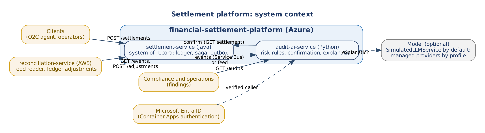
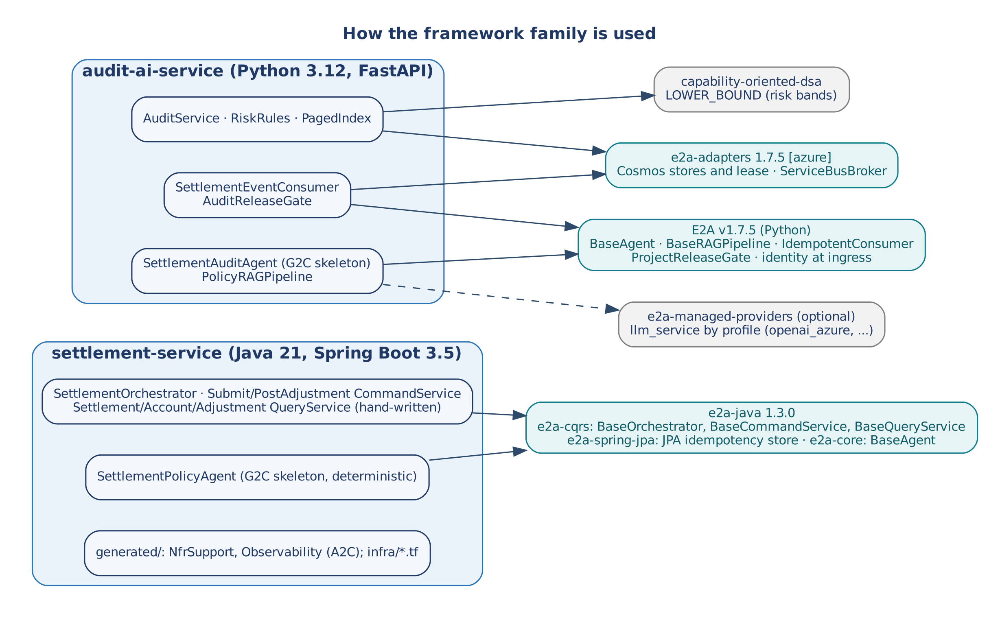
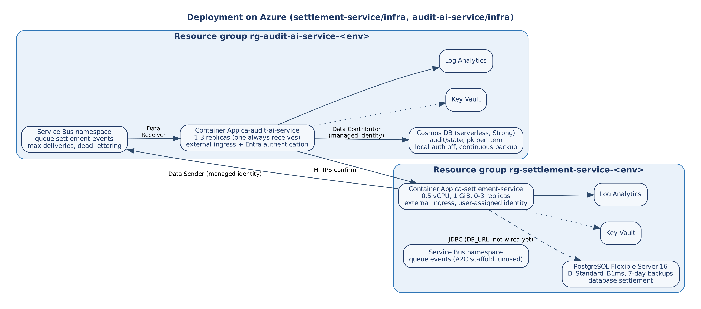
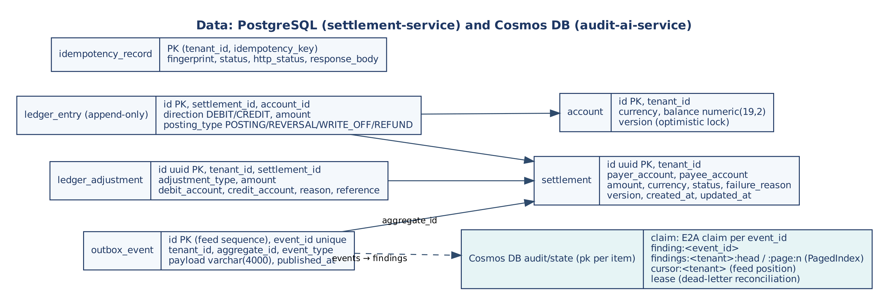
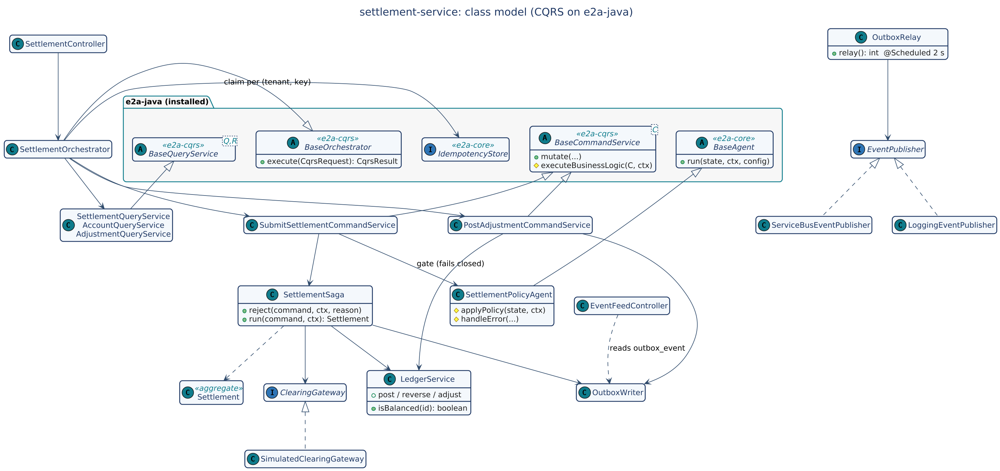
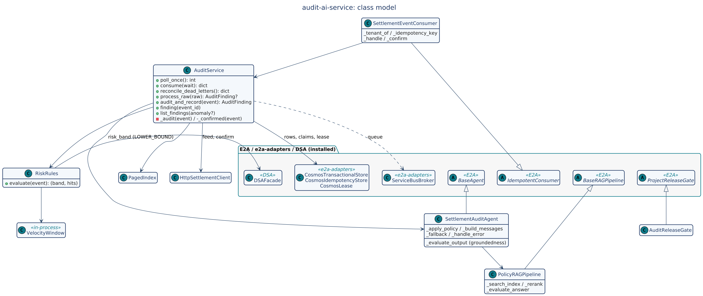
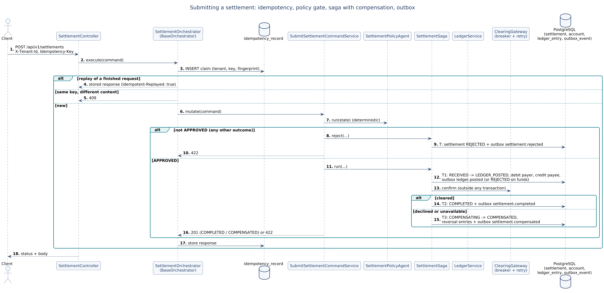
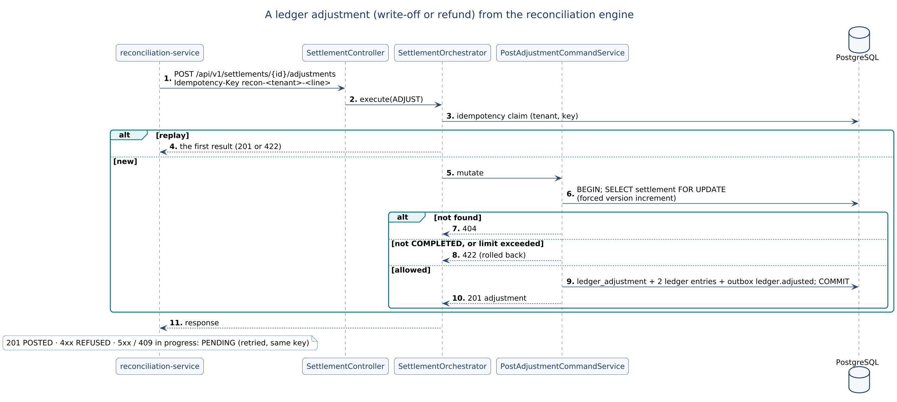
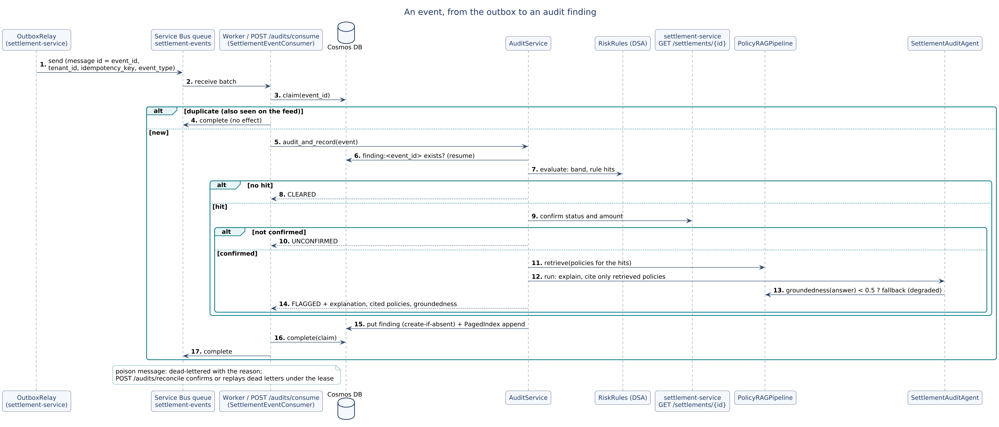
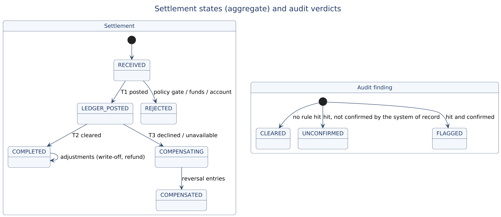

# Financial Settlement Platform — Design

### High-Level and Low-Level Design

*This document describes the two services of `financial-settlement-platform`. `settlement-service` (Java) is the deterministic system of record of the Order-to-Cash landscape: it moves money between ledger accounts exactly once, keeps the ledger balanced, and announces every outcome as an event. `audit-ai-service` (Python) audits those outcomes with deterministic risk rules, confirms each one with the system of record, and has an E2A agent explain what the rules flagged. The document covers the design from the requirements down to class contracts, as the code on `main` implements it. It follows the structure of the E2A, A2C and e2a-managed-providers design documents, and refers to them rather than repeating them.*

| | |
|---|---|
| Project | `financial-settlement-platform` — services `settlement-service` and `audit-ai-service` |
| Document type | Design Document (HLD + LLD) |
| Author | Subham Gupta, Principal Platform Architect |
| Source baseline | `subhamviky/financial-settlement-platform` `main` at `a08e39e`:<ul><li>**settlement-service:** Java 21, Spring Boot 3.5.7, about 1,800 lines in 43 classes, Flyway V1–V2, `infra/*.tf`, 8 test classes. Built on **e2a-java 1.3.0** (`e2a-cqrs`, `e2a-spring-jpa`, `e2a-core`).</li><li>**audit-ai-service:** Python 3.12, FastAPI, about 900 lines, `infra/*.tf`, 11 test modules. Built on **E2A v1.7.5** and **e2a-adapters 1.7.5** `[azure]`.</li><li>**Shared:** `capability-oriented-dsa`; `contracts/events/`.</li></ul> |
| Date | 16 November 2026 |
| Status | Describes the code on `main`. Section 14 lists where the code and the original requirements differ, and the open gaps. |

## 1. Introduction

### 1.1 Purpose

Money must move exactly once, the ledger must always balance, and every outcome must be visible to the systems that depend on it (reconciliation, audit). Outcomes that look risky must be explained without letting a model decide anything. This document is the design reference for the two services that do this:
- the requirements (Sections 2 and 3) and principles (Section 4);
- the high-level design: context, how the framework family is used, components, deployment on Azure, integration and identity (Section 5);
- the data design (Section 6);
- the low-level design of each service: modules, class model and contracts (Sections 7 and 8);
- dynamic behaviour (Section 9), consistency and failures (Section 10);
- non-functional design (Section 11), configuration (Section 12), verification (Section 13), and gaps (Section 14).

### 1.2 Audience

| Reader | Read |
|---|---|
| Architects | Sections 2, 4, 5, 10 and 14 |
| Engineers | Sections 6 to 10 and 12 |
| Operations | Sections 5.4, 10, 11 and 12 |
| Reviewers of the frameworks | Section 5.2 and Section 8 |

### 1.3 Status labels

| Label | Meaning |
|---|---|
| **Implemented** | In the code on `main`, with tests that CI runs |
| **Configured** | Implemented, and active only when its setting is given |
| **Gap** | Not done, or done differently from what a requirement intended (Section 14) |

### 1.4 Source of truth and related documents

The code is the source of truth; this document explains it.

| Document | Where | Used for |
|---|---|---|
| Requirements and the first implementation guide | the private hub (`settlement/REQUIREMENTS.md`, `IMPLEMENTATION_GUIDE.md`) | Use cases, business rules (BR-1 to BR-12), acceptance criteria |
| E2A Framework — Agentic Core; E2A CQRS Profile | `e2a-framework/docs/design/core/`, `cqrs/` | `BaseAgent`, `BaseRAGPipeline`, the CQRS orchestrator, command and query services, claim states |
| e2a-java | `e2a-framework/java/` | The Java port: `e2a-core`, `e2a-cqrs`, `e2a-spring-jpa` |
| A2C, G2C and P0 Framework designs | `a2c-framework/docs/design/` | The scaffold, the agent skeletons, the Azure Terraform and NFR modules |
| e2a-managed-providers core design | `e2a-managed-providers/docs/design/core/` | Replacing the simulated model by a managed provider through a profile |
| Event contract | `contracts/events/settlement-event.v1.schema.json` | The events both services and the reconciliation engine depend on |

Product names (Microsoft Azure, Azure Container Apps, Azure Service Bus, Azure Cosmos DB and others) are trademarks of their owners and are used only to describe the design.

## 2. Problem and Requirements

### 2.1 The problem

- **Partial money movement.** A transfer debits one account and credits another. If a step fails in between, or a clearing house declines afterwards, the ledger must end up as if nothing happened, and it must show why.
- **Retries.** Clients retry. A retried request must not move money twice, and the same key with different content must be refused.
- **Events must match state.** Every state change must reach the event consumers, and no event may announce a change that did not commit.
- **AI on money.** Risk explanations are useful, but a model must never decide whether a settlement is flagged. An explanation must cite only real policy text.

### 2.2 Requirements traced to the design

| Requirement (hub `REQUIREMENTS.md`) | Design | Section |
|---|---|---|
| UC-1 Submit; BR-1 to BR-6 | `SubmitSettlementCommandService` → `SettlementPolicyAgent` → `SettlementSaga` (T1, clearing, T2 or T3) | 8.1, 9.1 |
| UC-2 Retry | `BaseOrchestrator` claim per (tenant, key), fingerprint, stored response | 8.1 |
| UC-3 Read | `SettlementQueryService`, `AccountQueryService` | 8.1 |
| UC-4 Consume events; BR-7 | `OutboxWriter` in the business transaction; `OutboxRelay`; `GET /api/v1/events` | 8.1, 9.3 |
| UC-5 Audit outcomes; BR-8 to BR-11 | `AuditService`: rules (DSA), confirmation, verdict | 8.2, 9.3 |
| UC-6 Review findings; BR-12 | `SettlementAuditAgent` + `PolicyRAGPipeline` (groundedness, fallback) | 8.2 |
| NFRs (requirements Section 6) | Section 11 | 11 |

### 2.3 What changed since the requirements were written

The requirements describe the first build. The code has moved on; Section 14 lists each difference.
- **Ledger adjustments.** settlement-service accepts write-offs and refunds of a completed settlement (`POST /settlements/{id}/adjustments`), used by the reconciliation engine, and emits `ledger.adjusted`.
- **Events over Service Bus.** The Service Bus `EventPublisher` is implemented, with managed identity. The outbox relay sends to audit-ai's queue. This was a backlog item.
- **audit-ai's state is durable.** It lives in Cosmos DB (E2A ports through e2a-adapters), shared by every replica. Findings were in memory in v1.
- **One consumer for both paths.** audit-ai settles events from the queue and from the feed with E2A's `IdempotentConsumer`, and reconciles its dead letters.
- **Identity at ingress** (E2A v1.7.4) is implemented for audit-ai, through Container Apps authentication with Entra ID.
- **A release gate.** audit-ai has one on E2A's `ProjectReleaseGate`, scoring a golden evaluation set.
- **The Java CQRS base moved.** It now comes from **e2a-java** (`e2a-cqrs`, `e2a-spring-jpa`) instead of a hand port.

## 3. Use Cases and Non-goals

### 3.1 Actors

| Actor | Interaction |
|---|---|
| Client (O2C agent, operators) | Submits settlements, reads settlements and balances |
| reconciliation-service (AWS) | Reads the event feed; posts adjustments |
| audit-ai-service | Consumes events; confirms settlements |
| Compliance and operations | Read findings |
| Clearing house | Confirms or declines a posted settlement (simulated) |
| Model | Explains a flag (simulated by default) |

### 3.2 Use-case catalogue

| ID | Use case | Outcome |
|---|---|---|
| UC-1 | Submit a settlement | COMPLETED, REJECTED (policy, funds, account) or COMPENSATED (clearing), money moved exactly once |
| UC-2 | Retry a submission | The stored response; nothing executed again |
| UC-3 | Read a settlement or a balance | Current, tenant-scoped state |
| UC-4 | Consume events | Ordered events after a position (feed), or each event on the queue |
| UC-5 | Audit outcomes | CLEARED, FLAGGED or UNCONFIRMED per completed or compensated settlement |
| UC-6 | Review findings | Findings with explanation, cited policies and groundedness |
| UC-7 | Adjust a completed settlement | A write-off (within the limit) or a refund (within the amount), posted once |

### 3.3 Non-goals

- A separate ledger service and a cross-service saga. The saga runs in one service; cross-service consistency is the reconciliation engine's job.
- A real clearing house integration.
- A user interface.

## 4. Design Principles and Invariants

### 4.1 Principles

| Principle | Where it shows |
|---|---|
| **Deterministic controls decide, execute and confirm; probabilistic intelligence explains** (E2A) | The policy agent is deterministic and fails closed. audit-ai's rules decide the flag and the system of record confirms it. The model only explains. |
| **CQRS** (E2A CQRS profile, e2a-java) | One orchestrator; commands through `BaseCommandService.mutate`, reads through `BaseQueryService.fetch` |
| **Local transactions with compensation** | Saga steps T1, T2, T3 each in one transaction; clearing outside any transaction |
| **Transactional outbox** | Every state change writes its event in the same transaction |
| **Effectively-once effects under at-least-once delivery** | Idempotency claims (settlement-service); E2A claims per event (audit-ai) |
| **Money is decimal** | `numeric(19,2)`, `BigDecimal`, `Decimal`; amounts are strings in events |

### 4.2 Invariants

| ID | Invariant | Enforced by |
|---|---|---|
| I-1 | A request is executed at most once per (tenant, key) | The `idempotency_record` primary key (atomic insert claim) |
| I-2 | For every settlement, total debits equal total credits | `LedgerService` always writes a debit and a credit of the same amount; `isBalanced` |
| I-3 | Ledger entries are never updated or deleted | Append-only entries; compensation and adjustments write new entries |
| I-4 | No money moves unless the policy gate approved | `SubmitSettlementCommandService`: anything but `APPROVED` rejects |
| I-5 | No state change without its event, and no event without its change | `OutboxWriter` inside the same transaction |
| I-6 | Only legal state transitions | `Settlement.moveTo` (`SettlementStatus.canMoveTo`) |
| I-7 | Write-offs on a settlement total at most the limit; refunds at most its amount | Row lock with forced version increment, then the check, in one transaction |
| I-8 | An event is audited at most once, on any path | E2A claim per `event_id` (Cosmos DB), resumable handler |
| I-9 | A flag requires confirmation by the system of record | `AuditService._confirmed` |

## 5. High-Level Design

### 5.1 System context



### 5.2 How the framework family is used



| Framework | settlement-service | audit-ai-service |
|---|---|---|
| **AI-DLC / P0** | Maven project, Dockerfile, Makefile, dev container, first tests (`aidlc/requests/settlement-service.json`) | Poetry project, FastAPI `main.py`, Dockerfile, first test (`aidlc/requests/audit-ai-service.json`) |
| **G2C** | `SettlementPolicyAgent` skeleton | `SettlementAuditAgent` skeleton on the installed E2A |
| **A2C** | Spec, Azure Terraform (Container App, Service Bus, Key Vault, Log Analytics) and its test, `NfrSupport` (breaker, retry), `Observability` | The same Terraform shape, release workflow |
| **E2A** | **e2a-java 1.3.0:**<ul><li>`BaseOrchestrator`, `BaseCommandService`, `BaseQueryService`, `CqrsRequest`/`CqrsResult` (`e2a-cqrs`);</li><li>the JPA idempotency store (`e2a-spring-jpa`);</li><li>`BaseAgent` and `RequestContext` (`e2a-core`).</li></ul> | **E2A v1.7.5:**<ul><li>`BaseAgent`, `BaseRAGPipeline`, `SimulatedLLMService`;</li><li>`IdempotentConsumer` and `PhysicalOutcome`;</li><li>`ProjectReleaseGate`, identity at ingress, conformance.</li></ul> |
| **e2a-adapters** | — | `[azure]`: `CosmosTransactionalStore`, `CosmosIdempotencyStore`, `CosmosLease`, `ServiceBusBroker`, `identity_at_ingress` (`azure_container_apps`) |
| **e2a-managed-providers** | — (no model) | Optional. A profile can replace `build_audit_llm()` with a managed `llm_service` (for example `openai_azure` on Azure). The provider repository's CI runs audit-ai's suite on every profile. |
| **DSA** | — | Governed `LOWER_BOUND` for risk bands; it refuses unsorted bands |

### 5.3 Logical architecture

| Component | Service | Responsibility |
|---|---|---|
| `SettlementController`, `EventFeedController` | settlement | HTTP exposure; headers to `CommandContext` |
| `SettlementOrchestrator` | settlement | Routes actions; idempotency (inherited) |
| `SubmitSettlementCommandService`, `SettlementSaga` | settlement | Policy gate, then T1, clearing, T2 or T3 |
| `PostAdjustmentCommandService` | settlement | Write-offs and refunds of completed settlements |
| `LedgerService` | settlement | Double entry |
| `OutboxWriter`, `OutboxRelay`, `EventPublisher` | settlement | Events in the transaction; relay to Service Bus or log |
| `AuditService` | audit-ai | Feed, queue and dead letters; audit one event; findings |
| `SettlementEventConsumer` | audit-ai | E2A consumer: claim, handle, confirm |
| `RiskRules`, `VelocityWindow` | audit-ai | Bands, velocity, clearing-decline |
| `SettlementAuditAgent`, `PolicyRAGPipeline` | audit-ai | Explanation grounded in retrieved policies |
| `PagedIndex` | audit-ai | The tenant's finding list in bounded pages |

### 5.4 Deployment on Azure



| Service | Resources (Terraform) |
|---|---|
| settlement-service (`settlement-service/infra`) | <ul><li>Resource group; Log Analytics.</li><li>User-assigned identity.</li><li>Container App: 0.5 vCPU, 1 GiB, 0–3 replicas, external ingress, liveness on the health path.</li><li>Key Vault, with Secrets User for the identity.</li><li>A Service Bus namespace and queue `events`, from the A2C scaffold and unused by the code.</li><li>PostgreSQL Flexible Server 16 (`B_Standard_B1ms`, 32 GB, 7-day backups); the admin password is a variable with no default.</li><li>`events.tf`: the target queue on audit-ai's namespace, and the identity's principal id as an output.</li></ul> |
| audit-ai-service (`audit-ai-service/infra`) | <ul><li>Resource group; Log Analytics.</li><li>User-assigned identity.</li><li>Container App: 1–3 replicas, so one always receives from the queue; external ingress.</li><li>Key Vault.</li><li>Service Bus namespace with queue `settlement-events`: max deliveries, dead-lettering on expiry, Data Receiver for the identity.</li><li>`events.tf`: Data Sender on that one queue for settlement-service's identity.</li><li>`cosmos.tf`: Cosmos DB, serverless, Strong consistency, single region, local auth off, continuous 7-day backup, container `audit/state` with `/pk` and per-item TTL, Data Contributor for the identity.</li><li>`identity.tf`: Container Apps authentication environment; the auth itself is configured with `az containerapp auth`.</li></ul> |

The two stacks are wired by outputs:
- audit-ai's `settlement_events_namespace` and `settlement_events_queue` become settlement-service's `audit_events_namespace` and `audit_events_queue`;
- settlement-service's `events_publisher_principal_id` becomes audit-ai's `event_publisher_principal_ids`.

No secret is exchanged: both sides use managed identities.

### 5.5 Integration and contracts

| Interface | Producer → consumer | Contract |
|---|---|---|
| Settlement events | settlement-service → audit-ai (Service Bus queue, and the feed); → reconciliation (feed) | `settlement-event.v1.schema.json`:<ul><li>**Envelope:** `event_id`, `event_type`, `schema_version` "1", `occurred_at`, `tenant_id`, `correlation_id`, `settlement`, and `adjustment` for `ledger.adjusted`.</li><li>**Amounts** are strings with two decimals.</li><li>**Service Bus message:** id = `event_id`; properties `tenant_id`, `idempotency_key`, `event_type`.</li></ul> |
| `GET /api/v1/events?afterSequence=&limit=` (≤ 500) | settlement-service → consumers | `{events: [{sequence, event}], next_after_sequence}`, ascending, tenant-scoped |
| `GET /api/v1/settlements/{id}` | settlement-service → audit-ai (confirmation) | Settlement view: status, amount |
| `POST /api/v1/settlements/{id}/adjustments` | reconciliation → settlement-service | `{type, amount, reason, reference}` with `X-Tenant-Id` and `Idempotency-Key` |

CI validates the events the Java tests really produce against the schema. The reconciliation engine vendors the schema and checks it for drift.

### 5.6 Identity and security

- **audit-ai-service.**
  - **Verification:** Container Apps authentication with Entra ID verifies every caller (`Return401`, `/health` excluded).
  - **Identity:** the service takes the caller from `X-MS-CLIENT-PRINCIPAL` only, through `identity_at_ingress`. The Entra directory is mapped to the deployment's tenant (`AUDIT_TENANT`), and a role can be required.
  - **Fail closed:** with identity enabled and authentication not configured, every `/audits` call is 401.
- **settlement-service.** The API takes the tenant from the `X-Tenant-Id` header, and its ingress is external with no authentication configured. This is the most important open gap (G-1): any caller that can reach it can act for any tenant.
- **Service-to-service.**
  - **Service Bus:** settlement-service → audit-ai uses managed identity (Data Sender on one queue).
  - **HTTP:** audit-ai → settlement-service and reconciliation → settlement-service send `X-Tenant-Id` only.
- **Secrets.** None in code or Terraform. Cosmos DB has local authentication off. The PostgreSQL admin password is a variable without a default.

### 5.7 Model access

- **audit-ai:** `build_audit_llm()` returns E2A's `SimulatedLLMService`, which writes a policy-citing explanation. A managed provider replaces it by profile, without code changes.
- **settlement-service:** calls no model. Its agent is deterministic: `buildMessages` returns null, so the lifecycle has no model step.

## 6. Data Design



**settlement-service (PostgreSQL; H2 in PostgreSQL mode locally and in tests; Flyway owns the schema):**

| Table | Key | Notes |
|---|---|---|
| `account` | `id` | `tenant_id`, `currency`, `balance numeric(19,2)`, `version` (optimistic lock). Demo accounts for `acme`: ACC-1000, ACC-2000, ACC-3000, ACC-BLOCKED, ACC-WRITEOFF. |
| `settlement` | `id uuid` | The aggregate: accounts, amount, currency, status, failure_reason, version, timestamps |
| `ledger_entry` | `id` identity | Append-only: settlement_id, account_id, direction, amount, posting_type (POSTING, REVERSAL, WRITE_OFF, REFUND); index on settlement_id |
| `ledger_adjustment` | `id uuid` | tenant, settlement, type, amount, debit and credit accounts, reason, reference; index (tenant, settlement) |
| `outbox_event` | `id` identity (= the feed's sequence) | `event_id` unique, tenant, aggregate_id, event_type, `payload varchar(4000)`, published_at; index (published_at, id) |
| `idempotency_record` | (`tenant_id`, `idempotency_key`) | fingerprint, status, http_status, response_body (e2a-spring-jpa) |

**audit-ai-service (Cosmos DB `audit/state`, one logical partition per item; in memory without `AUDIT_STATE_BACKEND=cosmos`):**

| Item | Key | Notes |
|---|---|---|
| Claim | E2A layout | One per `event_id`: state, owner, expiry, result |
| Finding | `finding:<event_id>` | Created once (`put_if_version(..., None)`) |
| Finding index | `findings:<tenant>:head`, `findings:<tenant>:page:<n>` | `PagedIndex`: pages of 500 ids, compare-and-set appends, so no document grows past Cosmos DB's limit |
| Feed position | `cursor:<tenant>` | Moves forward only (compare-and-set) |
| Lease | E2A layout | One dead-letter reconciliation at a time |

## 7. Low-Level Design — Module Structure and Class Model

### 7.1 settlement-service packages

| Package | Classes |
|---|---|
| `api` | `SettlementController`, `EventFeedController`, `ApiExceptionHandler` |
| `settlement` | `Settlement`, `SettlementStatus`, `SettlementOrchestrator`, `SubmitSettlementCommand(Service)`, `SettlementSaga`, `SettlementQueryService`, `AccountQueryService`, `ClearingGateway`, `SimulatedClearingGateway`, views and repository |
| `adjustment` | `PostAdjustmentCommand(Service)`, `AdjustmentQueryService`, `LedgerAdjustment`, `AdjustmentType`, view and repository |
| `ledger` | `LedgerService`, `Account`, `LedgerEntry`, `LedgerRejection`, repositories |
| `outbox` | `OutboxWriter`, `OutboxEvent`, `OutboxRelay`, `EventPublisher`, `ServiceBusEventPublisher`, `LoggingEventPublisher`, `EventPublisherConfig`, repository |
| `service` | `SettlementPolicyAgent` |
| `config` | `SettlementConfig`, `PolicySettings` |
| `generated` (A2C) | `NfrSupport`, `Observability`, `SettlementServiceService` |



### 7.2 audit-ai-service modules

| Module | Contents |
|---|---|
| `main.py` | Wiring; the background worker `consume_forever`; `/health` |
| `routers/audits.py`, `routers/identity.py` | The API; `require_identity` |
| `services/audit_service.py` | `AuditService` |
| `services/consumer.py` | `SettlementEventConsumer`, `AUDITED_TYPES`, `CONSUMER_CONFIG` |
| `services/state.py` | `state_ports()`, `event_ports()` (memory or Cosmos DB; Service Bus or none) |
| `services/risk_rules.py` | `risk_band`, `VelocityWindow`, `RiskRules` |
| `services/policy_rag.py` | `PolicyRAGPipeline` |
| `services/paged_index.py` | `PagedIndex` |
| `services/settlement_client.py` | `HttpSettlementClient` |
| `services/llm.py` | `build_audit_llm()` (the swap point) |
| `agents/settlement_audit_agent.py` | `SettlementAuditAgent` |
| `models/events.py`, `contracts/settlement_event.py` | Event, finding and rule-hit models; the contract |
| `release/gate.py` | `AuditReleaseGate` |
| `policies/*.md`, `evals/golden.json` | Policy clauses (POL-AML-01, POL-AML-02, POL-OPS-03); the release evaluation set |



## 8. Low-Level Design — Class Contracts

### 8.1 settlement-service

| Class | Contract |
|---|---|
| `SettlementOrchestrator` (`BaseOrchestrator`) | Commands (`settlement.submit`, `settlement.adjust`) are claimed per (tenant, `Idempotency-Key`) with a fingerprint of the business content:<ul><li>**Replay:** returns the stored response with `Idempotent-Replayed: true`.</li><li>**Conflict:** the same key with different content is 409.</li><li>**In progress:** another request with the key is running: 409.</li></ul>Reads are not claimed. `handleError` counts `<action>.error` and logs. |
| `SubmitSettlementCommandService` | Runs `SettlementPolicyAgent` with the policy settings in its `RequestContext`. Anything but `APPROVED` → `saga.reject` → 422. Otherwise `saga.run` → 201 (COMPLETED or COMPENSATED) or 422 (REJECTED on funds or account). SLO 2,500 ms. |
| `SettlementPolicyAgent` (`BaseAgent`) | Deterministic `applyPolicy`. The violations: payer equals payee; amount above `max_amount` (1,000,000.00); a blocked account. Any violation sets `REJECTED` and raises a typed `GovernanceRefusal` (POLICY_VIOLATION). `handleError` also sets `REJECTED`: the gate fails closed. |
| `SettlementSaga.run` | **T1** (transaction): save RECEIVED; post (debit payer, credit payee); LEDGER_POSTED + `ledger.posted`, or REJECTED + `settlement.rejected` on `LedgerRejection`. **Clearing**, outside any transaction: `retryWithBackoff` (2 retries, 50 ms base) behind a breaker (5 failures, 30 s). **T2:** COMPLETED + `settlement.completed`. Or **T3:** COMPENSATING → reversal entries → COMPENSATED + `settlement.compensated`, with the reason. |
| `LedgerService` | `post`: funds-checked debit and credit of the same amount, POSTING. `reverse`: never funds-checked, REVERSAL. `adjust`: funds-checked, WRITE_OFF or REFUND. Accounts must exist for the tenant and match the currency, else `LedgerRejection`. |
| `PostAdjustmentCommandService` | In one transaction:<ol><li>Lock the settlement (forced version increment).</li><li>404 if it is unknown for the tenant.</li><li>422 unless it is COMPLETED, and unless the total of this type stays within the ceiling (write-offs: `write-off-limit` 5.00; refunds: the settled amount).</li><li>Save the adjustment, post it, and write `ledger.adjusted`.</li></ol>**Write-off:** debit the payee, credit `ACC-WRITEOFF`. **Refund:** debit the payee, credit the payer. A concurrent adjustment loses the lock and gets 409. |
| `OutboxWriter` | Builds the v1 envelope; stores it in `outbox_event`, inside the caller's transaction |
| `OutboxRelay` | Every 2 s, in a transaction: the oldest 100 unpublished events, in order → `publish` → `markPublished`. At-least-once: a crash after publishing re-publishes; consumers de-duplicate on `event_id`. |
| `ServiceBusEventPublisher` | A synchronous send per event: body = payload, message id = `event_id`, the properties above. A failure throws, so the batch rolls back and is retried. |
| `EventFeedController` | Tenant-scoped outbox rows after `afterSequence`, ascending, `limit` clamped to 1–500 |

### 8.2 audit-ai-service

| Class | Contract |
|---|---|
| `AuditService.consume(wait)` | One batch from the Service Bus queue through `SettlementEventConsumer`; `DISABLED` without a broker. The background worker calls it in a loop. |
| `AuditService.poll_once()` | Reads the feed after the shared position. Each audited type goes through `process_raw`, which uses the same consumer and claim, so an event seen on both paths is audited once. Other types are skipped (tolerant reader). The position moves forward by compare-and-set. |
| `AuditService.reconcile_dead_letters()` | Under the lease: confirms each dead letter (`_confirm`), removes the confirmed ones, and replays those that never took effect |
| `AuditService.audit_and_record(event)` | **Resumable:** returns an existing finding. Otherwise:<ul><li>no rule hit: **CLEARED**;</li><li>a hit not confirmed by the system of record (same status and amount): **UNCONFIRMED**;</li><li>a confirmed hit: retrieve policies, run the agent, **FLAGGED** with explanation, cited policies, groundedness and `degraded`.</li></ul>The finding is created once, and appended to the paged index. |
| `SettlementEventConsumer` | `_tenant_of`: the envelope's tenant; dead-lettered if the message property disagrees. `_idempotency_key`: `event_id`. `_handle`: unaudited types are acknowledged unread; otherwise validate and audit. `_confirm`: COMMITTED if a finding exists. Config: lease 120 s, resume expired claims. |
| `RiskRules.evaluate(event)` | **Band** by DSA `LOWER_BOUND` (LOW ≤ 10,000; MEDIUM ≤ 100,000; HIGH ≤ 250,000; CRITICAL above). HIGH or CRITICAL → `large-amount` (POL-AML-01). More than 5 completed settlements from one payer within 1 hour → `velocity` (POL-AML-02). A compensated settlement → `clearing-decline` (POL-OPS-03). |
| `SettlementAuditAgent` (`BaseAgent`) | `_apply_policy`: requires a tenant and at least one rule hit. `_build_messages`: the settlement, the hits, the retrieved policy paragraphs. `_evaluate_output`: groundedness = the share of cited policy ids that were retrieved. Below 0.5, or on an error, `_fallback`: a rule-only explanation marked `degraded`. |
| `PolicyRAGPipeline` (`BaseRAGPipeline`) | Keyword index over policy paragraphs, keeping each paragraph's policy id and source file. A paragraph scores its word overlap with the query, plus 10 when its policy id is named. Rerank keeps the top 3. |
| `PagedIndex` | Append with compare-and-set on the last page; opens a new page when full; reads back each id once |
| `AuditReleaseGate` (`ProjectReleaseGate`) | Scores `evals/golden.json`: each case needs the right verdict, band and cited policies, and a flag must be grounded (1.0) and not degraded. Threshold 1.0. |

### 8.3 HTTP APIs

| Service | Route | Responses |
|---|---|---|
| settlement | `POST /api/v1/settlements` (`X-Tenant-Id`, `Idempotency-Key`, optional `X-Correlation-Id`) | 201 COMPLETED or COMPENSATED · 422 REJECTED · 409 conflict or in progress · 400 invalid |
| settlement | `GET /api/v1/settlements/{id}`, `GET /api/v1/accounts/{id}/balance` | 200 · 404 |
| settlement | `POST /api/v1/settlements/{id}/adjustments` | 201 · 404 · 422 · 409 |
| settlement | `GET /api/v1/settlements/{id}/adjustments` | 200 |
| settlement | `GET /api/v1/events?afterSequence=&limit=` | 200 feed |
| settlement | `GET /actuator/health` (also `info`, `prometheus`) | 200 |
| audit-ai | `GET /audits?anomaly=`, `GET /audits/{settlementId}` | 200 · 404 |
| audit-ai | `POST /audits/poll`, `POST /audits/consume`, `POST /audits/reconcile` | 200 |
| audit-ai | `GET /health` | 200, no identity required |

## 9. Dynamic Behaviour

### 9.1 Submitting a settlement



### 9.2 A ledger adjustment



### 9.3 From the outbox to an audit finding



### 9.4 States



## 10. Consistency, Concurrency and Failures

| Situation | What happens | Mechanism |
|---|---|---|
| A client retries a finished request | The stored response, `Idempotent-Replayed: true` | Idempotency claim |
| Two requests with one key at once | One runs; the other gets 409 (in progress) | Atomic insert claim |
| Two settlements debit one account at once | One commits; the other fails its optimistic lock and is an error (not retried) | `account.version` |
| Insufficient funds or a wrong account | REJECTED, nothing posted | `LedgerRejection` in T1 |
| Clearing declines, or stays unavailable after retries | COMPENSATED with reversal entries; balances restored; ledger balanced | T3 |
| **The process stops between T1 and T2 or T3** | The settlement stays LEDGER_POSTED; no job finishes or compensates it | **Gap G-2** |
| Two adjustments of one settlement at once | One commits; the other gets 409 | Forced version increment on the settlement row |
| An adjustment would pass the limit | 422, rolled back | Check inside the locked transaction |
| The relay crashes after sending | Re-sent; consumers de-duplicate | At-least-once and `event_id` |
| **Two replicas relay at once** | Both may send the same events | Consumers de-duplicate (audit-ai's claim; the reconciliation engine's conditional puts); see G-4 |
| Service Bus send fails | The batch rolls back; retried on the next tick | Synchronous send in the relay's transaction |
| An event arrives on the queue and on the feed | Audited once | One claim per `event_id` on both paths |
| An audit replica stops mid-event | The next delivery takes over the expired claim and finishes; an existing finding is returned | `consumer_resume_expired`, resumable handler |
| A poison message (bad JSON, tenant mismatch, invalid event) | Dead-lettered with the reason; `/audits/reconcile` confirms or replays | Consumer |
| settlement-service unreachable during confirmation | The audit errors; the message is redelivered | Queue redelivery and claim |
| The model answers ungrounded text or fails | A rule-only explanation, `degraded: true` | Groundedness < 0.5, `_fallback` |

## 11. Non-Functional Design

| NFR | Design |
|---|---|
| Idempotency and consistency | Sections 4.2 and 10 |
| Reliable events | Transactional outbox; a 2-second relay; Service Bus with max deliveries and dead-lettering; a pull feed for catch-up and for other consumers |
| Resilience | Clearing behind a breaker with retries, then compensation; the audit worker loop logs and continues |
| Latency | Submission SLO 2.5 s (`BaseCommandService` logs breaches) |
| Tenancy | Every repository query by tenant; the feed filtered by tenant; audit-ai's identity mapped to one tenant per deployment |
| AI governance | Rules decide, the system of record confirms, the model explains; groundedness measured; release gate at 1.0 on the golden set |
| Security | Managed identities for Service Bus and Cosmos DB; Cosmos local auth off; no secrets in code; settlement-service authentication open (G-1) |
| Observability | Actuator health, info and Prometheus; `Observability` error counters; Log Analytics. audit-ai: standard logging. |
| Scalability | settlement-service scales 0–3; audit-ai 1–3 with shared state. Velocity counts are per replica (G-3). |
| Cost | Serverless Cosmos DB; scale-to-zero settlement-service; B1ms PostgreSQL for non-production |

## 12. Configuration

| Setting | Service | Default | Purpose |
|---|---|---|---|
| `settlement.policy.max-amount`, `blocked-accounts` | settlement | 1,000,000.00; ACC-BLOCKED | Policy gate |
| `settlement.clearing.max-amount` | settlement | 250,000.00 | Simulated clearing declines above |
| `settlement.adjustments.write-off-limit`, `write-off-account` | settlement | 5.00; ACC-WRITEOFF | Adjustments |
| `settlement.outbox.relay-interval-ms` | settlement | 2000 | Relay schedule |
| `SETTLEMENT_EVENTS_SERVICEBUS_QUEUE`, `_NAMESPACE`, `_CONNECTION_STRING`, `AZURE_CLIENT_ID` | settlement | unset: logging publisher | Service Bus publisher (managed identity, or emulator) |
| `DB_URL`, `DB_USER`, `DB_PASSWORD` (profile `prod`) | settlement | — | PostgreSQL (not yet set by Terraform: G-5) |
| `AUDIT_TENANT`, `SETTLEMENT_API_URL`, `POLICY_DIR` | audit-ai | acme; `http://localhost:8080`; `policies/` | Wiring |
| `AUDIT_STATE_BACKEND`, `COSMOS_ENDPOINT`, `COSMOS_DATABASE`, `COSMOS_CONTAINER`, `COSMOS_KEY` | audit-ai | memory; —; audit; state; — | State ports (managed identity unless a key is set) |
| `SERVICEBUS_NAMESPACE` or `SERVICEBUS_CONNECTION_STRING`, `SERVICEBUS_QUEUE` | audit-ai | unset; settlement-events | Queue consumer |
| `E2A_IDENTITY_SOURCE`, `E2A_IDENTITY_TENANT_MAP`, `AUDIT_REQUIRED_ROLE` | audit-ai | set by `identity.tf` | Identity at ingress |

## 13. Verification and Evidence

| Evidence | What it proves |
|---|---|
| settlement-service tests (8 classes, 21 test methods; H2; the Service Bus publisher on the emulator in CI) | AC-1 to AC-8: completion, replay, conflict, policy and funds rejection, compensation, the feed, validation. Adjustments (write-off, refund, limits, concurrency, replay). Publisher selection. The policy agent's contract. |
| audit-ai tests (11 modules, 35 test functions; again with Cosmos DB and Service Bus emulators, several replicas on one container) | AC-9 to AC-16: verdicts, confirmation, de-duplication across paths, degraded fallback, risk rules, contracts. Shared state, the queue consumer and dead letters, identity at ingress, the paged index. |
| CI `audit-ai-service` | The tests twice (memory; emulators), E2A conformance (strict), the release gate on `evals/golden.json` |
| CI `contracts` | The events settlement-service's tests produced satisfy the schema |
| CI `terraform` | Both stacks: `fmt`, `validate`, `terraform test` with mock providers |
| e2a-managed-providers CI, project-suites | audit-ai's suite on every managed-provider profile |

## 14. Gaps, Deviations and Backlog

| # | Item | Kind | Notes |
|---|---|---|---|
| G-1 | settlement-service trusts `X-Tenant-Id` and has public ingress with no authentication | Gap (security) | Add identity at ingress for Java (e2a-java has no ingress module yet), or Container Apps authentication plus a claims check; or make ingress internal and call it only from the other services |
| G-2 | A settlement left in LEDGER_POSTED by a crash between T1 and T2/T3 is never finished or compensated | Gap (consistency) | A scheduled recovery: re-run clearing or compensate settlements older than a timeout |
| G-3 | `VelocityWindow` counts in process memory: per replica, lost on restart | Gap | Keep the window in the shared store, or count from the feed |
| G-4 | `OutboxRelay` runs on every replica without a lock | Note | Correct (at-least-once, consumers de-duplicate), but duplicates are sent under scale-out; a lease or `SELECT ... FOR UPDATE SKIP LOCKED` would avoid them |
| G-5 | `DB_URL` and the password secret are not set on the Container App by Terraform | Gap (deployment) | From the requirements' backlog; needed for a real deployment |
| G-6 | The A2C scaffold's Service Bus namespace and queue `events` in settlement-service's stack are unused | Note | Remove, or use for something specific |
| G-7 | `outbox_event.payload` is `varchar(4000)` | Limit | Long reasons could exceed it; `text` would remove the limit |
| G-8 | audit-ai's settlement-service client has no circuit breaker or retry | Gap | Retries come from queue redelivery; the feed path fails the poll |
| G-9 | `minReplicas` 0 for settlement-service: no relay runs while scaled to zero | Note | Events wait in the outbox until a request wakes a replica; set 1 if timeliness matters |
| D-1 | The requirements list the Service Bus publisher and durable findings as backlog | Done since | Implemented (Sections 5.4, 6) |

## Appendix A — Source files

| Area | Files |
|---|---|
| settlement-service | `src/main/java/com/subhamviky/settlement/**`, `src/main/resources/application*.yml`, `db/migration/V1__settlement_schema.sql`, `V2__ledger_adjustments.sql`, `pom.xml`, `infra/*.tf` |
| audit-ai-service | `src/audit_ai_service/**`, `policies/`, `evals/golden.json`, `pyproject.toml`, `infra/*.tf` |
| Contracts | `contracts/events/settlement-event.v1.schema.json`, `examples/`, `tools/validate_samples.py` |
| CI | `.github/workflows/settlement-ci.yml`, `aidlc-scaffold.yml` |

The diagrams are rendered from `diagrams/` (Graphviz `.dot` and PlantUML `.puml`, sharing `common/style.puml`):

```
dot -Tpng -Gdpi=220 diagrams/<name>.dot -o images/<name>.png
java -jar plantuml.jar -tpng -o ../images diagrams/<name>.puml
```
